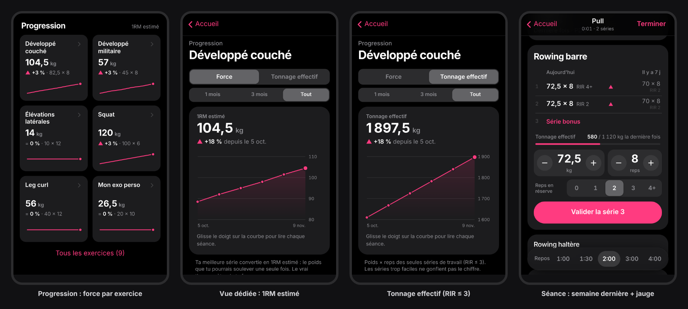

# GymLog

Le carnet de muscu qui ne te ralentit pas. Pensé pour la salle : mains pleines de magnésie, cardio haut, 90 secondes de repos.



**Un seul écran, pas d'onglets.** De haut en bas, par ordre d'usage :

1. **La séance du jour** en un bouton (« Commencer Pull »), ou « Reprendre » si une séance est en cours. Un jour de repos, la carte montre **la prochaine séance** (« Pull · Mercredi ») avec « La faire maintenant ».
2. **Ta semaine** : séances faites, prévues, jours de repos ; touche un jour pour changer sa séance. Une pastille **🔥 N semaines** quand tu enchaînes les semaines au rendez-vous (jamais de « 0 » culpabilisant).
3. **Ta progression** : une carte par exercice avec sa **force** (1RM estimé de ta meilleure série) et sa mini-courbe. **Touche une carte** pour la vue dédiée : courbe semaine après semaine (glisse le doigt pour lire chaque séance), bascule vers le **tonnage effectif**, records, et chaque séance consultable.
4. **Tes séances** (Push, Pull, Legs, Upper, Lower, Full body…) : ▶ pour démarrer, toucher pour **renommer** ou changer les exercices (touche un exercice pour le renommer, régler sa fourchette ou sa note) (le nouveau nom suit dans tout l’historique), **glisser vers la gauche pour supprimer** (avec « Annuler »). « Nouvelle séance » : **séance libre tout de suite** (en tête), ou une séance réutilisable, vide ou depuis un modèle.

Pendant la séance, tout est sur la carte de l'exercice :

- **La semaine dernière, côte à côte** : chaque série de travail en face de la même série de la dernière fois (poids × reps · RIR). La ligne « À battre » montre exactement quoi dépasser.
- **Double progression par fourchette** (ex. 8–12, réglable en un tap) : on monte les reps jusqu'en haut de la fourchette sur toutes les séries, puis on charge et on repart du bas. L'objectif du jour est pré-rempli.
- **Objectif série par série** : après chaque série, l'objectif de la suivante suit ce que tu viens de faire. Échec → même charge, une rep de moins (jamais plus de reps qu'à la série d'avant) ; perdre 1 à 2 reps d'une série à l'autre est de la fatigue normale, la charge ne baisse pas ; vraie chute (3 reps ou plus sous l'objectif) → −5 % ; trop facile (RIR ≥ 3) → +1 rep ou un cran de plus. La fourchette ne s'impose pas en pleine séance : elle décide seulement quand charger la fois suivante.
- **Progression de la séance** dans l'en-tête : « 4/9 séries » et un trait rose (prévu = séries de la dernière fois, 3 pour un exercice nouveau).
- **Glisser une série vers la gauche** pour la supprimer, avec « Annuler » (le même geste que pour les séances types).
- **Forme du jour** : « Fatigué / Normal / En forme », toujours visible en haut de la séance et modifiable à tout moment. Jour sans → objectifs à −5 % ; en forme → on charge un cran plus tôt.
- **Échauffements** : un tap sur « Échauffement », la montée est proposée (50 % × 10, 70 % × 5, 85 % × 3). Ils sont notés mais exclus de « À battre », des records et des courbes. 60 s de repos seulement.
- **Drop sets** : un tap sur « Drop set » après une série (−20 % pré-rempli). Comptés dans le volume, exclus des comparaisons et des records. Un RIR 0 s'affiche « Échec ».
- **Supersets** : « ⋯ » → « Superset avec… ». Après une série du premier exercice, la carte bascule seule sur le second, sans repos ; le repos part après le second. Mémorisé dans la séance type.
- **Ta courbe sans quitter la séance** : l'icône courbe sur l'exercice ouvert.
- **Note par exercice** (« banc cran 3, prise 2 doigts »), réglée dans « ⋯ », affichée sur la carte et gardée d'une séance à l'autre.
- **Alerte de stagnation** : si la force ne progresse plus depuis 3 séances, un conseil discret (séance allégée ou variante).
- **Records en direct** : dès qu'une série bat ton meilleur 1RM estimé ou ton record à ce nombre de reps, la ligne s'illumine (« Nouveau record »), et le bouton l'annonce avant même de valider (« ★ Record »).
- **Le repos démarre tout seul** à chaque série validée : durée mémorisée par exercice, 60 s seulement après un échauffement. Au repos, une seule pastille « Repos 2:00 » ; les autres durées s'ouvrent en la touchant. À la fin, l'écran entier clignote en rose (visible à 2 mètres), avec bip et vibration.
- **Pensé pour le pouce** : toutes les cibles font au moins 44 px, la mise en page s'adapte jusqu'à l'iPhone SE, Valider reste toujours au-dessus du chrono, et chaque série validée s'allume brièvement.

**À la fin, un récapitulatif** : durée et **calories actives estimées** (MET selon ton effort réel × ton poids × le temps entre ta 1re et ta dernière série ; ordre de grandeur ±30 %), séries de travail, records battus, tonnage effectif, et chaque exercice comparé à ta dernière séance du même type. « Partager le récap » en fait une image à envoyer aux potes.

**Onglet Progrès**, en 4 blocs : **Force** (une carte par exercice, puis ton **niveau** Novice → Élite sur squat, développé couché, soulevé de terre et développé militaire : meilleur 1RM estimé ÷ poids de corps, avec la charge à viser pour le palier suivant ; poids de corps et repères hommes/femmes derrière l'avatar, des ordres de grandeur, pas une note) · **Volume** par muscle (séries dures uniquement, ½ pour les muscles secondaires et les drop sets, repère 10–20, alerte au-delà de ~10 séries pour un muscle dans une séance ; le lundi, la semaine dernière s'affiche tant que la semaine est vide) · **Régularité** (calendrier des 12 dernières semaines, « 🔥 N semaines » en en-tête, et la **semaine de décharge** proposée quand plusieurs exercices stagnent : moitié des séries, charge presque intacte) · **Dernières séances**. Sans aucune séance, un seul message clair remplace les blocs vides. Dans la vue d'un exercice : **records par reps**.

**Sauvegarde en 1 tap** : le menu « Partager » du téléphone (iCloud Drive, Google Drive, AirDrop…), avec un rappel sur l'accueil quand des séances ne sont pas à l'abri. **Envoyer une séance type à un pote** : un lien, sans serveur ; il l'ajoute en un tap.

**Une erreur de saisie ?** Dans le détail d'une séance passée, touche une série pour corriger sa charge, ses reps ou son RIR, la supprimer ou la passer en échauffement (avec « Annuler »). Objectifs, records et courbes se recalculent aussitôt.

**Le bouton « ⋯ » d'un exercice** regroupe ce qu'on règle rarement : son **nom** (ajoute une variante, une prise, une machine : l'historique et les records restent attachés ; deux exercices ne peuvent pas porter le même nom), sa **fourchette de reps**, sa **note** (réglage machine, prise), l'ordre (**monter / descendre**), **remplacer** si la machine est prise (les séries déjà faites restent sur l'original), **superset** avec l'exercice suivant, ou retirer.

**Premier lancement** : un seul écran de 20 secondes — ton prénom, tes jours d'entraînement, les séances que tu gardes (les autres disparaissent). Le planning se remplit tout seul (« Lun Push · Mer Pull · Ven Legs »). « J'ai déjà une sauvegarde » restaure un ancien téléphone.

**Séance oubliée ?** Dans le récapitulatif de fin (ou le détail d'une séance passée) : « Aujourd'hui · Hier · Autre jour ». L'heure et la durée suivent ; régularité, repos et objectifs restent justes.

**Un seul message par carte**, juste au-dessus de la saisie, selon une priorité stricte : le coach (objectif ajusté après une série) > l'alerte de stagnation > l'objectif du jour. La note de l'exercice est une ligne grise en bas de carte.

Et aussi : sauvegarde à chaque tap (avec alerte immédiate si le stockage sature), écran qui reste allumé pendant la séance, fonctionne hors-ligne, export/import JSON (derrière l'avatar).

## Démarrer

```bash
npm install
npm run dev
```

Ouvre l'URL « Network » affichée sur ton téléphone (même Wi-Fi).
En `http://` sur le réseau local, l'écran qui reste allumé et le hors-ligne sont désactivés : ils exigent HTTPS, donc GitHub Pages.

## Tests

```bash
npm test          # 83 tests unitaires (Vitest)
npm run test:e2e  # 24 parcours dans un vrai navigateur (Playwright), en iPhone 13 et iPhone SE
```

Les tests unitaires couvrent la logique critique : 1RM ajusté au RIR, double progression par fourchette, forme du jour, décharge, échauffements, drop sets, supersets, records, volume par muscle, régularité, migration des données, sauvegardes, envoi de séance par lien.
Les parcours rejouent la salle : séance avec record et récapitulatif, forme du jour, drop set, superset, carte allégée (fourchette et note dans « ⋯ »), pastille de repos, correction d'une séance passée, volume, lien de séance, import corrompu, cibles tactiles.

Les deux tournent sur GitHub à chaque push : **si un seul test échoue, rien n'est mis en ligne.**

## Mettre en ligne (GitHub Pages)

1. Pousse le repo sur GitHub (branche `main`).
2. Settings → Pages → Source : **GitHub Actions**.
3. Chaque push sur `main` redéploie (`.github/workflows/deploy.yml`).

Sur le téléphone, ouvre l'URL puis **Partager → Sur l'écran d'accueil** (iOS) ou **Installer l'application** (Android).
Fais-le : sur iOS, Safari peut effacer les données d'un site non ouvert pendant 7 jours. Une app installée sur l'écran d'accueil n'est pas concernée.

## Structure

```
src/
├─ App.jsx                  onglets Entraînement / Progrès ⇄ séance en cours
├─ lib/
│  ├─ store.jsx             état global + persistance localStorage (2 clés)
│  ├─ defaults.js           91 exercices par muscle, modèles, migration des données
│  ├─ training.js           la logique de coach : 1RM × RIR, fourchettes, échauffements, stagnation
│  ├─ session.js            réordonner, remplacer, supersets, corriger une séance (logique pure, testée)
│  ├─ summary.js            récapitulatif de fin de séance (+ summaryImage.js : l'image partageable)
│  ├─ stats.js              volume par muscle, régularité, records par reps
│  ├─ share.js              envoyer une séance type par lien (encodage + validation)
│  ├─ backup.js             export signé + import validé champ par champ
│  └─ hooks.js              timer de repos, wake lock, horloge
├─ components/
   ├─ Home.jsx              onglet Entraînement (séance du jour, semaine, séances)
   ├─ ProgressTab.jsx       onglet Progrès
   ├─ SessionLogger.jsx     ★ la séance en cours (95 % du temps)
   ├─ ExerciseCard.jsx      ★ une carte d'exercice (+ exercise/ : tableau, saisie, échauffements & drop sets)
   ├─ ProgressSection.jsx   une carte de force par exercice, cliquable
   ├─ ProgressDetail.jsx    vue dédiée : courbe, force / tonnage effectif, records
   ├─ Charts.jsx            graphiques SVG faits main (aucune librairie)
   ├─ SwipeRow.jsx          glisser pour supprimer
   ├─ ExercisePicker · TemplateEditor · SessionDetail · SettingsSheet
   └─ RestTimer · Stepper · Toast · Sheet · StorageAlert · ui · Icons
tests/                       Vitest : training, migrate, backup, session, records, coach2
e2e/                         Playwright : parcours réels en format téléphone
```

## Choix assumés

- **Le chrono ne sonne pas écran verrouillé.** Sur iPhone, une app web ne peut pas réveiller le téléphone sans serveur de notifications, ce qui casserait le « 100 % local ». Réponse retenue : l'écran reste allumé pendant la séance, et la fin du repos fait clignoter tout l'écran.
- **Mises à jour sans perte** : chaque changement de format passe par une migration testée (historique, notes, séance en cours, séances types, planning restent identiques), et une copie brute des données d'avant est gardée sur le téléphone (`gymlog:avant-mise-a-jour`).
- **Stockage protégé** : l'app demande au système de ne pas vider ses données quand l'appareil manque de place (`navigator.storage.persist()`), en plus du rappel de sauvegarde.
- **Écran de démarrage noir** (`scripts/splash.mjs` génère les images iOS) : pas de flash blanc à l'ouverture.

## Les indicateurs (pas de piège du tonnage brut)

Le tonnage brut ment : 10 séries bâclées à 40 kg « battent » 3 vraies séries lourdes. L'app suit donc :

- **La force** (indicateur principal) : ta meilleure série de travail, convertie en **1RM estimé** (Epley sur reps + RIR : 80 × 8 avec 3 reps en réserve compte plus que 80 × 8 à l'échec). Elle ne monte que si tu deviens plus fort.
- **Le tonnage effectif** : poids × reps des **seules séries de travail (RIR ≤ 3)**. Les séries trop faciles ne gonflent pas le chiffre.

Au poids du corps (tractions, dips à vide), on suit les reps.

## La règle de progression

Elle est dans `src/lib/training.js`, fonction `target()`. Double progression pilotée par la **1re série** (la seule faite sans fatigue accumulée), exemple 8–12 :

| Dernière fois (1re série)               | Objectif du jour                                                        |
| --------------------------------------- | ----------------------------------------------------------------------- |
| En haut de la fourchette (12)           | + 1 cran, reps **calculées** à la nouvelle charge (80 × 12 → 82,5 × 10) |
| Le cran ferait tomber sous 8 reps       | encore une rep avant de charger (haltères : 8 → 10 kg = +25 %)          |
| Pas encore en haut                      | même charge, + 1 rep (+2 si elle était nettement trop facile)           |
| Sous le bas de la fourchette (< 8)      | même charge, viser 8                                                    |

**Effort visé** : 1–2 reps en réserve sur les gros polyarticulaires (squat, soulevé de terre, développés, rowings barre : l'échec y coûte cher en fatigue pour le même muscle), 0–1 sur machines et isolation. Il sert aux reps calculées, au pré-remplissage du RIR et pour juger « trop facile ».

**Volume** : seules les séries dures comptent (RIR ≤ 3), un drop set compte ½. Au-delà de ~10 séries dures pour un muscle dans une seule séance, Progrès le signale : mieux vaut répartir.

**Décharge** : moitié des séries, charge −5 %, 3–4 reps de l'échec. On baisse le volume, pas l'intensité.

**Variantes biomécaniques** (réglages d'un exercice) : quand un exercice voisin est mieux placé, surtout pour charger le muscle étiré (extension triceps au-dessus de la tête, leg curl assis, curl incliné, élévations latérales à la poulie, mollets debout…), l'app le suggère avec un bouton pour l'essayer. Jamais imposé : on garde l'exercice qu'on aime.

Fourchettes par défaut : 5–8 sur les gros polyarticulaires, 6–10 sur les polyarticulaires, 8–12 en accessoire et en isolation, 12–20 pour les abdos et les petits muscles. Chacune se change dans « ⋯ ».

**Pendant la séance**, `setTargets()` ajuste l'objectif de chaque série suivante d'après la précédente (échec → même charge, −1 rep ; vraie chute de 3 reps ou plus → −5 % ; trop facile → +1 rep ou +1 cran). Sans imposer la fourchette.

Les flèches ▲ = ▼ comparent avec le 1RM estimé sur reps + RIR. Ainsi, 82,5 × 6 et 80 × 8 se jugent sur la même échelle.
